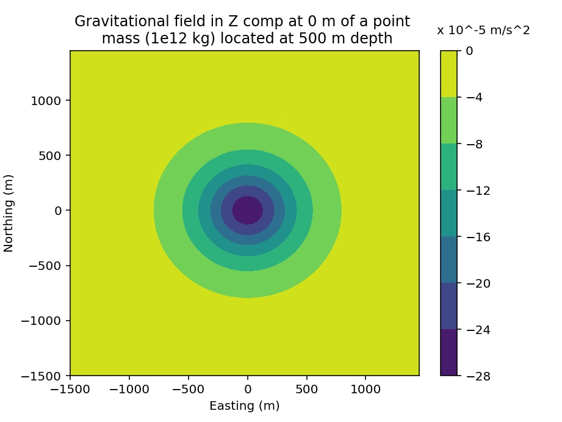

> This post is also part of my own learning. If you spot a mistake, please let me know.


While reading [Gravity and Magnetic Exploration: Principles, Practices, and Applications](https://www.cambridge.org/core/books/gravity-and-magnetic-exploration/20BABB4AAFCDF8DC7F4CB36B8359D482) by William J. Hinze, Ralph R. B. von Frese and Afif H. Saad (2012), I wanted to learn how to map the magnitude of a gravity field with `Python`. The task is fairly simple, but as a beginner I learned a lot by working through it step by step.

I hope this is useful for other `Python` beginners, and suggestions from experienced readers are welcome. The code below is simple and contains several simplifications, for example in the derivative, which I hope to improve later.

This post computes the gravity field ($ \boldsymbol{g} $) of a point mass $ m $ kg at a depth of $ d $ metres, in the $ x $, $ y $ or $ z $ component, by differentiating the gravitational potential $ U $. The gravitational potential is [1]:

$$ U = G \frac{m} {r} $$

where $ G $ is the gravitational constant, $ m $ the mass and $ r $ the distance, $ \sqrt{x^2 + y^2 + z^2} $. For the $ z $ component [2]:

$$ \boldsymbol{g_{z}} = \frac {\partial U}{\partial z} $$

Here I compute the derivative with the simple definition [3]:

$$ \boldsymbol{g_{z}} = \lim_{\Delta z \to 0} \frac {U(x,y,z+ \Delta z)-U(x,y,z)}{\Delta z} $$

Because the computation in `Python` is discrete, I choose $ \Delta z $ as small as possible, close to 0. The field could also be computed directly with [4]:

$$ \boldsymbol{g_{z}} = -G \frac{m \Delta z} {r^3} $$

but computing the derivative ourselves is a good exercise.

Let's put it into practice:

#### 1. Import the modules and define the constants
I use the mass and depth below; feel free to change them.
```python
import numpy as np
import matplotlib.pyplot as plt

# define some constants
G = 6.67408e-11 # gravitational constant
m = 1e12  # mass of a point mass in kg
d = -500 # depth of a point mass in m
```
The mass is 10^12 kg and the depth 500 m, matching the example in Gravity and Magnetic Exploration.

#### 2. Create the coordinates
First the coordinate ranges:
```python
# create x, y, z sparse
x = np.arange(-1500, 1500, 50)
y = np.arange(-1500, 1500, 50)
z = np.arange(-500, 10, 10)
```
The ranges are -1500 to 1450 m for `x` and `y`, and -500 to 0 m for `z`.
Then we build a _grid_ as a _3D array_:
```python
# create X, Y, Z grid
X, Y, Z = np.meshgrid(x, y, z)
```
Geophysicists will know this step as _gridding_.

#### 3. Define a function for the potential $ U $
A simple function to compute the gravitational potential:
```python
# define function for gravitational potential
def grav_potential(xi, yi, zi, m, d):
 "Calculate grav potential in a point in 3D space due to mass m in d depth, ex: grav_potential(X, Y, Z, 100, 5)"
 r = np.sqrt(xi**2 + yi**2 + (zi-d)**2)
 r[r==0]=np.nan #avoid dividing by zero
 pot = G * m / r
 return pot
```
Note the `zi-d` term in the distance to the _point mass_. `r[r==0]=np.nan` removes the value at `r=0` (at the point mass itself) to avoid a division by zero (`ZeroDivisionError`).

#### 4. Define the derivative with respect to $ z $ (the field)
We differentiate the gravitational potential into the $ z $ component of the gravity field with the derivative formula above [3].
```python
#define function for derivative
dz = 0.000001
def grav_field(Xi, Yi, Zi):
    "Calculate derivative in certain component, ex: grav_field(X, Y, Z+dz) --> Z component"
    field = ((grav_potential(Xi, Yi, Zi, m, d) - grav_potential(X, Y, Z, m, d)) / dz)
    return field
```
I use $ \Delta z $ = `dz = 0.000001`, which I consider close enough to `0`.

#### 5. Compute the derivative with respect to $ z $
For another component, move `dz` to that coordinate. The result is multiplied by `1e5` to get a convenient colour scale.
```python
# call the derivative
grav_z = grav_field(X, Y, Z+dz) * 1e5
```
The factor `1e5` is shown again in the colour bar label.

#### 6. Plot at depth 0
For another depth, replace the index `-1`; `z` runs from -500 to 0 in steps of 10. For example, -450 m is index `5`, -500 m is index `0` and -10 m is index `-2`.
```python
plt.contourf(X[:,:,-1], Y[:,:,-1], grav_z[:,:,-1])
```

#### 7. Finally, add the _plotting_ parameters
```python
plt.colorbar()
plt.text(1600, 1600, "x 10^-5 m/s^2")
plt.xlabel("Easting (m)")
plt.ylabel("Northing (m)")
plt.title("Gravitational field in Z comp at 0 m of a point \n mass (1e12 kg) located at 500 m depth")
plt.show()
```
And the result:
{: .img-fluid }

To check the result, you can set `m` to the mass of the Earth and `d` to the Earth's radius. This ignores the Earth's curvature, but is enough to check the order of magnitude of the gravity field. Thank you for reading.
